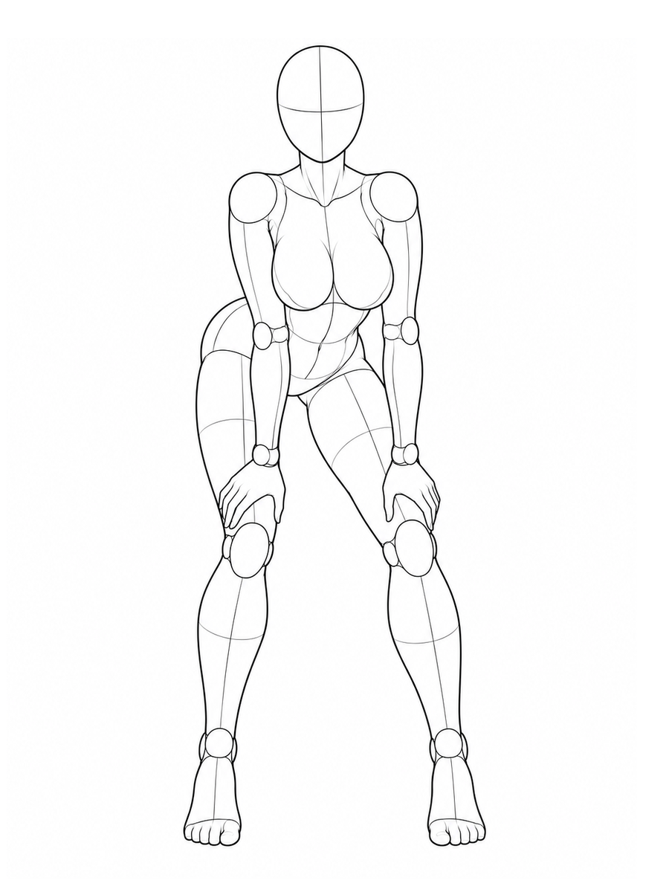
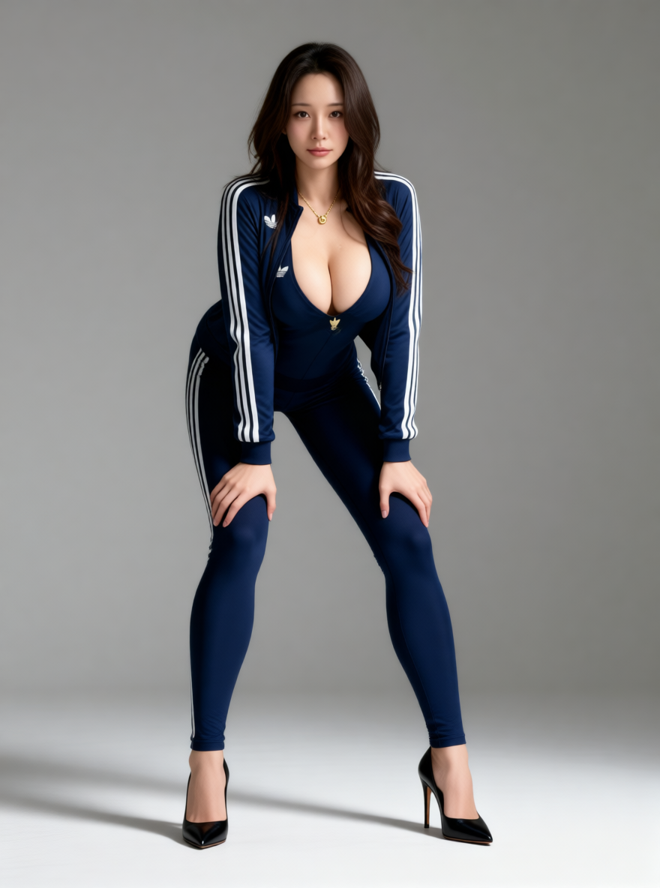

# 拍片哥 · AI 姿势参考库与生图工坊 (AI Pose Gallery & Studio)

> 288 组 / 1439 张 AI 人体姿势参考图，日文数据完整汉化，全新集成本地与多云端 **拍片哥 AI 姿势生图与试穿工坊**，附可直接部署的响应式画廊。

## 🎬 姿势参考 + 人物参考 → AI 生成结果

选择姿势骨架控制动作与构图，再上传人物/服装参考，即可生成同时保留目标姿势、人物面容与穿搭特征的完整图片。

| ① 姿势与构图参考 | ② 人物与服装参考 | ③ AI 融合生成结果 |
| :---: | :---: | :---: |
|  |  |  |
| 锁定身体动作、视角与画面构图 | 提供面容、发型与服装特征 | 将两份参考融合为完整真人效果图 |

> **上图即实际工作流：图 1 + 图 2 → 图 3。** 人物头像与服装均为可选输入；只选择姿势，也可以让模型自动完成人物与穿搭设计。

<details><summary>查看完整画廊与移动端预览</summary>


</details>

**维护者：** 拍片哥 · [GitHub @paipiange](https://github.com/paipiange)
**GitHub 仓库：** <https://github.com/paipiange/ai-pose-gallery-zh>
**原始数据作者：** ギア（@giaaibusi）
**原始站点：** <https://ai-pose-gallery.pages.dev/>
**原版汉化致谢：** Anhao · [X @anhao_ai](https://x.com/anhao_ai) / [anhao/ai-pose-gallery-zh](https://github.com/anhao/ai-pose-gallery-zh)

---

## 这是什么

原站是一套面向 AI 绘画 / 3D / 摄影参考的姿势图库，元数据全部为日文，且不提供批量素材下载。本仓库不仅完成了全量数据镜像与汉化，更全面升级研发了 **拍片哥 AI 姿势生图与试穿工坊**：

1. **全量镜像与汉化** —— 1439 条记录对应的缩略图与原图全部落地（共 2878 个文件 / 659.5 MB），4 个体系、26 个动作分类、288 个姿势名全部准确汉化。
2. **轻量原生画廊** —— 零框架依赖的高性能响应式画廊，支持多角度切换、按姿势分组与原图下载。
3. **拍片哥 AI 姿势生图工坊** —— 以 3D 白模为骨架，支持真实服装融合试穿、人脸局部头像面容复刻，打通 ComfyUI 本地工作流与主流云端模型。

## ✨ 拍片哥 AI 姿势生图与试穿工坊 (Pose AI Studio)

- **姿势骨架精准对齐**：选中任意姿势和拍摄视角，自动抽取人体素体并精准锁定动作构图。
- **真实面料试穿**：支持上传真实服装图或选用精选预置款式，根据人体受力自动模拟布料褶皱与垂坠光影。
- **人脸定制复刻**：支持拖拽或直接 `Ctrl + V` 粘贴人脸特写头像（门槛放宽至 32×32 局部特写），一键复刻神韵面容。
- **多模型灵活切换**：
  - **本地首选**：支持直连 ComfyUI 官方固定工作流（支持 `Qwen-Image-Edit-2511` 动态多图融合）。
  - **云端大模型**：内置 Google Gemini 3.1、字节火山方舟豆包视觉模型、OpenAI GPT-Image 等。
- **纯原生零泄露架构**：零打包、零构建工具，用户私有 Key 仅在浏览器本地 `localStorage` 留存，单次请求内存临时代理，绝不持久化落盘。
- **本地历史存储**：生成结果自动保存在浏览器本地 IndexedDB，支持单条导出超清大图、复用生成 Prompt 与本地历史清空。

## 页面功能

- 4 个体系页签，显示各体系的图片数与姿势组数
- 姿势名、编号、ID、分类关键词搜索，支持 `/` 快速聚焦
- 动作分类、5 种视角组合筛选，可一键重置
- **按姿势分组 / 逐张浏览**双模式，分组卡片带多角度缩略图
- 悬停或点击缩略图切换主图角度，点击卡片打开灯箱
- 灯箱先显示缩略图、再加载 900×1200 原图，支持直接下载 PNG、复制 ID、新窗口打开
- `← / →` 切换角度，`↑ / ↓` 切换姿势，`Esc` 关闭；手机支持左右滑动
- PC 多列网格、手机双列网格，移动端筛选面板可展开/收起
- 使用指南与注意事项弹窗，页脚标注图片来源与维护者链接

## SEO 与分享

页面内置了完整的 SEO 与社交分享配置：

- 关键词化标题：`AI 姿势参考库｜288 组人体姿势 · 1439 张多角度参考图`
- 独立 description、keywords、author 与 `max-image-preview:large`
- `canonical` 指向正式域名，避免自定义域名与 pages.dev 域名重复收录
- Open Graph / Twitter Card 使用 1200×630 的 `og-cover.jpg`
- JSON-LD 结构化数据：`WebSite` + `ImageGallery`，声明语言、简介与页面主图
- `robots.txt` 放行全站并声明 sitemap，`sitemap.xml` 指向首页
- 语义结构：单一 H1、分区 H2、卡片 H3；缩略图 `alt` 含姿势名与视角，图片懒加载

仓库中的项目地址统一指向 `https://github.com/paipiange/ai-pose-gallery-zh`。Fork 后如使用其他域名，需同步替换 `index.html` 的 canonical、`og:*`、`twitter:*`、JSON-LD，以及 `robots.txt`、`sitemap.xml` 中的地址。

## 数据规模

| 体系 | 条数 |
| --- | ---: |
| 全身单人・标准系 | 365 |
| 全身单人・性感系 | 399 |
| 上半身单人 | 400 |
| 双人缠绵 | 275 |
| **合计** | **1439** |

每条记录对应 5 个视角中的若干个：正面 / 斜侧 / 侧面 / 俯视 / 仰视。

## 目录结构

```
.
├── index.html              # 单页画廊（零依赖，直接打开即可）
├── robots.txt              # 搜索引擎抓取规则
├── sitemap.xml             # 站点地图
├── og-cover.jpg            # 1200×630 社交分享封面
├── data/
│   ├── pose.json           # 原始日文数据（1439 条，未改动）
│   ├── pose-zh.json        # 中文数据（前端实际读取，含检索字段）
│   ├── meta.json           # 原始体系分类
│   ├── meta-zh.json        # 中文体系分类
│   └── translations.csv    # 日⇄中对照表（323 条，便于校对）
├── backend/                # 拍片哥 AI 生图/换装高性能后端 (GoFrame v2)
│   ├── api/                # API 契约与接口结构
│   ├── internal/           # 控制器、多模型生图逻辑、安全流控
│   └── manifest/           # 配置文件与环境定义
├── presets/                # 生图工坊预置款式（女装/面料）
├── skills/                 # Agent 技能定义包 (Claude / OpenCode / Cursor)
├── thumbs/                 # 缩略图 1439 张 JPG 300×400（22 MB）
├── img/                    # 原图 1439 张 PNG 900×1200（637 MB）
├── scripts/
│   ├── download.py         # 并发下载器（48 线程 / 断点续传 / 自动重试）
│   ├── i18n.py             # 日译中词典（唯一值去重后的 323 条译文）
│   ├── apply_translation.py# 回填译文，生成中文数据
│   ├── verify.py           # 校验文件完整性（存在性 / 大小 / 图片头）
│   └── build.sh            # 生成 Cloudflare Pages 发布目录 dist/
├── docs/                   # README 页面预览图
├── _headers                # Cloudflare Pages 缓存策略
├── LICENSE
└── README.md
```

## 数据结构

`data/pose-zh.json` 字段说明：

| 字段 | 原日文字段 | 示例 | 说明 |
| --- | --- | --- | --- |
| `id` | — | `full_sexy_P001_front` | 唯一标识 |
| `体系` | `系統` | 全身单人・性感系 | 4 大类 |
| `姿势编号` | `ポーズ番号` | `P001` | 80 组编号 |
| `分类` | `分類` | 站姿 | 26 类动作 |
| `姿势名称` | `ポーズ名` | S形站姿・胯部侧顶 | 288 种描述 |
| `角度` | `アングル` | 正面 | 5 种视角 |
| `缩略图` | `サムネ` | `thumbs/…jpg` | 相对路径 |
| `原图` | `原寸` | `img/…png` | 相对路径 |
| `检索` | — | 拼接串 | 供前端模糊搜索 |

原始日文数据 `data/pose.json` 保持原样，字段名与站点接口一致，便于对照或回灌。

## 本地运行

### 1. 启动前端画廊
画廊通过 `fetch` 读取 JSON，需要静态 HTTP 环境：

```bash
# 在仓库根目录运行
python3 -m http.server 5500
# 浏览器打开 http://127.0.0.1:5500
```

### 2. 启动拍片哥 AI 生图后端（可选，生图工坊需要）
```bash
cd backend
go run main.go
# 默认监听 http://127.0.0.1:8000
```
启动后在前端画廊点击右上角 **「🎨 拍片哥 AI 工坊」** 即可体验一键姿势生图与试穿！

页面支持体系/分类/视角组合筛选、关键词搜索、分组与逐张浏览、多角度缩略图、懒加载、灯箱原图下载、键盘与触屏导航。

## 脚本用法

```bash
# 重新拉取全部图片（已存在的文件自动跳过，可反复执行）
python3 scripts/download.py
WORKERS=64 python3 scripts/download.py   # 调整并发

# 修改 scripts/i18n.py 中的译文后，重新生成中文数据
python3 scripts/apply_translation.py

# 校验 2878 个文件是否完整
python3 scripts/verify.py
```

## 部署到 Cloudflare Pages

仓库为纯静态站点，无框架、无依赖。

**方式一：GitHub 自动部署（推荐）**

1. 登录 Cloudflare Dashboard → **Workers & Pages** → **Create** → **Pages** → **Connect to Git**
2. 选择本仓库 → 生产分支 `main`
3. 构建设置照抄：

   | 字段 | 值 |
   | --- | --- |
   | Framework preset | `None` |
   | Build command | `bash scripts/build.sh` |
   | Build output directory | `dist` |

4. **Save and Deploy**，约 2–5 分钟得到 `https://<project>.pages.dev`
5. 之后每次 `git push` 自动重新发布

> ⚠️ **不要**把 Build output directory 直接填 `/`。仓库根目录含 `.git`（数百 MB），
> Cloudflare 会把它当静态资源扫描，pack 文件超过 25 MiB 单文件限制会导致构建失败。
> `scripts/build.sh` 只拷贝 `index.html`、`_headers`、`data/`、`thumbs/`、`img/` 到 `dist/`。
> 若确实想用根目录，仓库已附 `.assetsignore` 兜底排除非站点文件。

> 站点限制：单文件 ≤ 25 MiB、每次部署 ≤ 20,000 个文件。本仓库最大文件 917 KB、共 2883 个文件，均在限制内。

**方式二：命令行直传**

```bash
bash scripts/build.sh
npx wrangler pages deploy dist --project-name ai-pose-gallery-zh
```

`_headers` 已为 `img/`、`thumbs/` 配置一年期强缓存，图片不会重复回源。

## Agent 技能（Skills）

`skills/` 下提供 5 个 `SKILL.md` 格式的 Agent 技能，让 AI Agent 按姿势名 + 视角检索本仓库的白模图，作为生图 / 生视频的姿势参考：

| 技能 | 图片数 | 范围 |
| --- | ---: | --- |
| `pose-reference-standard` | 365 | 全身单人・标准系 |
| `pose-reference-upper` | 400 | 上半身单人 |
| `pose-reference-sexy` | 399 | 全身单人・性感系（18+） |
| `pose-reference-couple` | 275 | 双人缠绵（18+） |
| `pose-reference-all` | 1439 | 全部 |

每个技能含 `SKILL.md`（用法 + 姿势目录）与 `references/catalog.csv`；csv 的 `图片` 列是**相对技能根目录**的路径（`../../img/<id>.png`），直接复用本仓库 `img/`，不重复存图、不依赖外链。

### 安装：手动

技能通过相对路径读取仓库的 `img/`，所以要**保留整个仓库**，再把技能目录**软链**（不要复制）到 Agent 的技能目录。以 Claude Code 为例（个人技能目录 `~/.claude/skills/`，项目级为 `<项目>/.claude/skills/`）：

```bash
git clone --depth 1 https://github.com/paipiange/ai-pose-gallery-zh.git ~/ai-pose-gallery-zh
mkdir -p ~/.claude/skills
ln -s ~/ai-pose-gallery-zh/skills/pose-reference-standard ~/.claude/skills/pose-reference-standard
# 需要全部技能：for d in ~/ai-pose-gallery-zh/skills/pose-reference-*; do ln -s "$d" ~/.claude/skills/; done
```

重启 Claude Code 或新开会话后输入 `/skills`，能看到 `pose-reference-*` 即可。仓库移动位置后需重新建软链。

只想要可单独拷贝、自带图片（WebP）的版本，可用独立技能包仓库 [jasoncai0/pose-reference-skills](https://github.com/jasoncai0/pose-reference-skills)。

### 安装：让 Agent 帮你装

把下面这段话发给 Claude Code（或其他能执行命令的 Agent），按需改技能名：

```text
请帮我安装姿势参考技能：把 https://github.com/paipiange/ai-pose-gallery-zh 浅克隆到 ~/ai-pose-gallery-zh
（需要完整仓库，技能会用相对路径读取仓库里的 img/），然后把 skills/pose-reference-standard
软链到 ~/.claude/skills/pose-reference-standard（不要复制）。完成后检查
references/catalog.csv 里每一行的「图片」路径相对技能目录都能找到文件，告诉我总行数和缺失数。
```

要装全部技能，把「skills/pose-reference-standard」改成「skills/ 下全部 pose-reference-* 目录」。

## 内容提示

图库包含成人向姿势参考（部分分类名称涉及性行为术语），仅供艺术创作、动作参考与前端技术学习使用。请勿用于违法用途。未成年人请勿访问。

## 版权与致谢

- **图片与原始数据的著作权归原作者ギア所有**，来源地址见页首
- 本仓库仅为个人学习、汉化与静态站点实践存档，**不对图片主张任何权利**，也不构成对原作品的商业使用授权
- 若原作者认为本仓库侵犯其权益，请通过 Issue 联系，将立即删除相关内容
- `scripts/` 与 `index.html` 的代码以 MIT 协议开源（见 [LICENSE](LICENSE)），该协议**不覆盖** `img/`、`thumbs/` 与 `data/` 中的图片和原始数据
